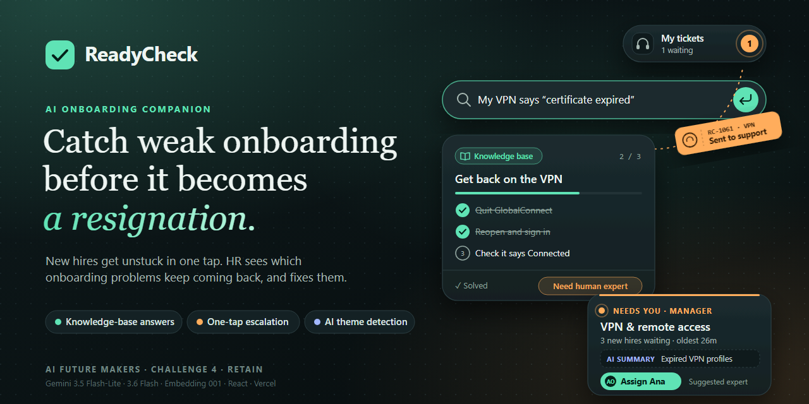
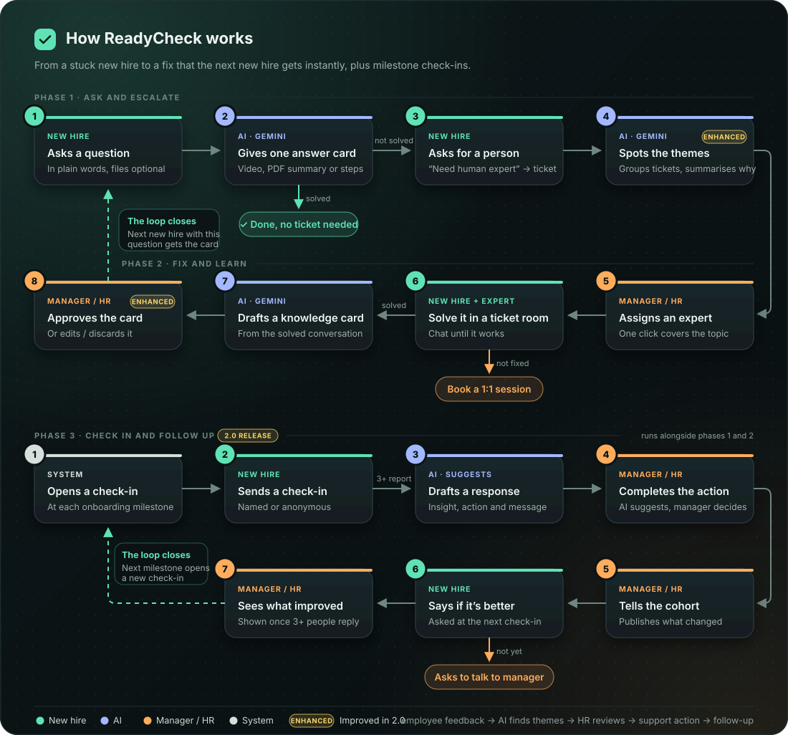
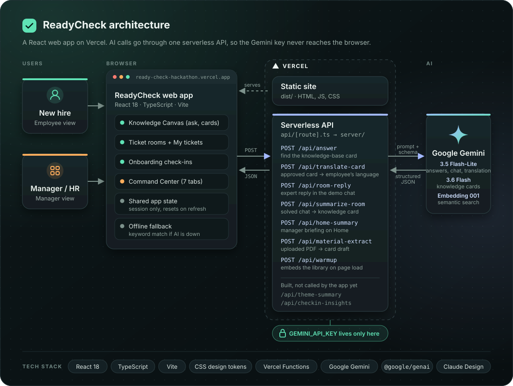

# ReadyCheck



**An AI onboarding companion that helps new employees get unstuck, and shows HR where onboarding is failing.**

Built for AI Future Makers · Challenge 4 (Retain): Early Employee Disengagement.

**Live demo:**[[ready-check-hackathon.vercel.app](https://ready-check-hackathon.vercel.app/)]

---

## The problem

New employees get stuck on small things in their first weeks: the VPN doesn't work, they don't know who their buddy is, they're unsure how to claim an expense.

- They don't know who to ask, so many questions never get asked.
- Each question is small, so HR never sees the pattern.
- A new hire who stays stuck feels unsupported and starts to disengage.
- HR often only finds out in the exit interview, when it's too late.

### This is a real, common problem

| Finding | Source |
|---|---|
| Only **12%** of employees strongly agree their organisation does a great job of onboarding new employees. | [Gallup](https://www.gallup.com/workplace/247172/problems-onboarding-program.aspx) |
| Up to **20%** of employee turnover happens in the **first 45 days**. | O.C. Tanner research, reported by [SHRM](https://www.shrm.org/in/topics-tools/news/hr-magazine/original-onboarding-options-4-hr-leaders) |
| **31%** of people surveyed had quit a job within the **first six months**. Clearer responsibilities (23%) and better training (21%) were among the changes that would have kept them. | BambooHR survey, reported by [HR Dive](https://hrdive.com/news/many-employees-quit-early-due-to-poor-onboarding-survey-says/405359) |
| When managers take an active role in onboarding, employees are **3.4×** as likely to say their onboarding was exceptional. | [Gallup](https://www.gallup.com/workplace/247172/problems-onboarding-program.aspx) |

These studies are a few years old and mostly from the US, but they point the same way as the challenge brief: new hires leave early because of unclear expectations, weak onboarding and too little support, and those problems are visible long before they resign.

## Our solution

ReadyCheck is one website with two views.

ReadyCheck reads three signals, all of them voluntary:

| Signal | Where it comes from |
|---|---|
| **Stuck** | The questions a new hire chooses to ask, and whether a card or a person solved them |
| **Onboarding pulse** | Five milestone check-ins with questions tailored to each stage; Yes, Partly, Not yet or Not applicable, plus optional follow-up prompts and an open note |
| **Acted on** | Whether a support action was completed and, at the next check-in, whether the people who reported the difficulty say it is better |

**For new employees** - - Ask a question in plain words
- AI gives **one answer card**: a short video, a policy summary, or a step-by-step checklist. Asked in another language, the approved card is translated and labelled, with "Show original".
- If it doesn't help, tap **Need human expert**. The question becomes a ticket.
- Chat with the assigned expert in a **ticket room**. If it's still not fixed, book a **1:1 session**.
- **Onboarding check-ins:** five milestones: Week 1 (Getting Started), Week 2 (Early Adjustment), Day 30 (Building Competence), Day 60 (Growing Independence) and Day 90 (Successful Integration), each with four questions tailored to its stage. Answers are Yes, Partly, Not yet or Not applicable. Partly or Not yet reveals an optional follow-up prompt, and an optional open note accepts any language. Employees choose to share by name or anonymously, and can edit a submitted check-in for 5 minutes.
- **"Is this better now?":** at the next check-in, employees are asked about each difficulty they reported and can answer Better or Not yet. With Not yet they can ask to talk to their manager, which shares their name and the topic but not their answers.
- **Team updates:** a notification tells the cohort what changed because of their feedback, with a link to a guide if there is one.

**For managers and HR**
- **Needs you:** questions are grouped into topics (for example "VPN" or "Payroll"), with an AI summary of why people are stuck.
- **One click** assigns an expert to everyone stuck on that topic.
- **Check-ins:** completed and pending check-ins, difficulties that still need a response, reported improvement, a milestone timeline and how many people shared their name. Illustrative sample data is labelled.
- **Onboarding pulse:** response distributions for each milestone, shown only after at least 3 employees check in. Partly and Not yet describe reported difficulties, not employee risk. Check-ins are for onboarding support, not performance evaluation.
- **Support priorities:** a difficulty reported by at least 3 employees becomes a priority with four steps: **AI insight → Manager action → Tell your cohort → Follow-up outcome**.
- **Follow-up responses:** what employees said when asked if things improved, shown once at least 3 people reply. Names appear only on named check-ins. A reply does not prove that the action caused the change.
- **Requests to talk:** employees who chose to give their name to talk about a topic.
- **Knowledge base:** when a problem is solved, AI writes a new answer card. A manager approves it, so the next new hire gets the answer instantly. Each live card shows how many new hires it has answered since.
- **Home:** open and overdue tickets, expert time saved, time to an answer, and an AI suggestion for what to do next.
- **Trends:** see which topics come up most, by day, week, month or all time. Click a theme to see its bottleneck, the evidence and a recommended action.

## Version 1 vs Version 2

Version 1 helped new employees get answers and connected unresolved questions to a human expert. Version 2 keeps that workflow and adds a second loop: it asks new hires how onboarding is going at each milestone, helps managers respond, and checks whether the response helped.

| Area | Version 1 | Version 2 |
|---|---|---|
| **Onboarding check-ins** | Not included. | Five milestones with stage-specific questions, optional follow-up prompts and notes in any language, named or anonymous sharing, and a 5-minute edit window. |
| **Manager view of onboarding** | Not included. Managers only saw questions and tickets. | New **Check-ins** tab with the onboarding pulse, milestone timeline and sharing overview. Cohort details need at least 3 check-ins. |
| **Responding to difficulties** | Assign an expert to a stuck topic. | Keeps expert assignment and adds **Support priorities** for cohort-level difficulties: AI insight, manager action, and a message to the cohort. |
| **Closing the loop** | Not included. | Employees get a team update and are asked "Is this better now?" at their next check-in. Managers see reported improvement and requests to talk, without claiming the action caused the change. |
| **Home** | Open tickets, overdue tickets, share resolved by cards, and active rooms. | Adds expert time saved and time to an answer. Solved by cards and In progress sit in the strip above every tab. |
| **Trends** | Which question topics come up most, by day, week, month or all time. | Clicking a theme now shows its bottleneck, evidence and a recommended action. Question themes stay separate from check-ins. |
| **Knowledge base** | Approve AI-drafted cards. | Each live card also shows how many new hires it has answered. |
| **Quality and demo tools** | Not included. | Adds `npm run eval`, a 53-question answer-quality test, and a `?presenter` status pill for live demos. |

## Workflow



1. **New hire** asks a question.
2. **AI** gives one answer card based on company's knowledge base. If it helps, done.
3. If not, the **new hire** taps *Need human expert* and a ticket is created.
4. **AI** groups tickets by topic and summarises why people are stuck.
5. **Manager / HR** assigns an expert in one click.
6. The **new hire and expert** solve it in a ticket room. If it's still not fixed, they book a 1:1.
7. **AI** drafts a knowledge card from the solved conversation.
8. **Manager / HR** approves it, so the next new hire with the same question gets the answer straight away.

Alongside it runs the milestone check-in loop:

1. **New hire** sends a check-in, named or anonymous.
2. **Manager / HR** sees any difficulty that at least 3 employees reported as a support priority.
3. **Manager / HR** plans and completes an action, then publishes a short message to the cohort.
4. **New hire** is asked "Is this better now?" at their next check-in, if they reported that difficulty.
5. **Manager / HR** sees how many people say it is better once at least 3 have replied.

Question themes stay on the Trends page; check-in feedback stays on the Check-ins page.

## How we use AI

We use **three Google Gemini models**, each picked for its job:

| Model | Used for | Why this model |
|---|---|---|
| **Gemini 3.5 Flash-Lite** (`GEMINI_CHAT_MODEL`) | Choosing the answer card, reranking search results, detecting the question's language, translating the approved card, small-talk replies, the AI expert in rooms, topic and Home summaries | Fast and low-cost for short, frequent answers |
| **Gemini 3.6 Flash** (`GEMINI_SUMMARY_MODEL`) | Turning a solved chat or uploaded PDF into a knowledge card | Stronger at reading longer content and writing accurate steps |
| **Gemini Embedding 001** (`GEMINI_EMBEDDING_MODEL`) | Semantic search: finds the knowledge-base cards that mean the same as the question, even with different words | Turns text into vectors for similarity search |

| What AI does | What a person still decides |
|---|---|
| Finds the matching card in the knowledge base. If nothing matches, it says so and suggests a human expert instead of guessing | The employee says if it helped, or asks an expert |
| Groups tickets into topics and summarises each topic | The manager decides who to assign |
| Translates an approved card into the employee's language | The approved English card stays one tap away ("Show original") |
| Turns a solved chat, or an uploaded PDF, into a draft knowledge card | The manager approves, edits or discards it |
| Plays the expert in the demo chat (labelled "AI expert (demo)") | In real use, real experts reply |

**Live AI and demo presets.** Everything in the tables above calls Gemini. In this prototype, the AI insights, suggested actions and cohort message drafts on the Check-ins page, and the theme analysis on the Trends page, are written in advance to show the intended experience. They do not call Gemini yet.

**How an answer is found**
1. **Search:** Embedding 001 compares the question with every knowledge-base card and keeps the closest ones.
2. **Rerank:** Flash-Lite puts those candidates in order of how well they answer the question.
3. **Answer:** Flash-Lite picks one card (manager-approved cards first), or replies "I don't know" and points to a human expert.
4. **Fallback:** if Gemini is unavailable, simple keyword matching takes over, so the app keeps working.

**Responsible by design**
- Uses only questions employees **choose** to ask and check-ins they **choose** to send. No monitoring, no emotion detection, no "flight risk" score.
- The employee chooses whether to share a check-in by name or anonymously, and can edit it for 5 minutes after sending.
- Anonymous means anonymous to the manager. The system keeps the link so it can ask that person the follow-up question, and the manager never sees who was asked.
- Cohort answers need at least 3 check-ins. Replies on a shared topic need at least 3 replies, and stay hidden if exactly one reply is unidentified, so it can't be worked out from the others.
- The AI never predicts resignation or judges performance. AI suggests; a manager decides.
- Every AI output is **labelled** in the app.
- Nothing AI writes reaches employees until a **manager approves** it. Translations are of approved cards only.
- Cards shown to future hires name the expert, never the employee or their room.
- The API key stays on the server, never in the browser.

For the full AI pipeline, see [technicalREADME.md](technicalREADME.md).

## Tech stack

| Part | Technology |
|---|---|
| Front end | React 18, TypeScript, Vite |
| Styling | CSS with design tokens (dark and light themes) |
| AI | Google Gemini API (`@google/genai`): Gemini 3.5 Flash-Lite, Gemini 3.6 Flash, Gemini Embedding 001 |
| Search | Embedding-based semantic search (cosine similarity) + Gemini reranking |
| Back end | Vercel serverless functions |
| Hosting | Vercel |
| Design | Claude Design |

## Architecture



- **Browser:** the React web app has both the employee and manager views.
- **Vercel:** serves the website and runs one serverless API. The Gemini API key is stored only here.
- **Google Gemini (3 models):** Embedding 001 for search vectors, 3.5 Flash-Lite for answers and chat, 3.6 Flash for knowledge-card summaries. All return structured JSON.
- **Retrieval:** the server keeps an in-memory vector index, ranks candidates with cosine similarity, then uses Gemini as a semantic reranker. It falls back to keyword matching if embeddings are unavailable.

| API endpoint | What it does | Model |
|---|---|---|
| `/api/answer` | Finds the best knowledge-base card for a question, or says "I don't know" | Embedding 001 + 3.5 Flash-Lite |
| `/api/theme-summary` | Summarises why people are stuck on a topic | 3.5 Flash-Lite |
| `/api/home-summary` | Briefs the manager on the Home dashboard and suggests who to assign | 3.5 Flash-Lite |
| `/api/room-reply` | Writes the expert's reply in the demo chat | 3.5 Flash-Lite |
| `/api/summarize-room` | Turns a solved chat into a knowledge card | 3.6 Flash |
| `/api/material-extract` | Turns an uploaded PDF into a knowledge card draft | 3.6 Flash |
| `/api/checkin-insights` | Retained backend capability for check-in themes and named summaries; the Check-ins page does not request or display these | 3.6 Flash |
| `/api/translate-card` | Translates the chosen approved card into Malay, Chinese or Tamil, string for string | 3.5 Flash-Lite |
| `/api/warmup` | Embeds the library on page load so the first question is fast | Embedding 001 |

The vector index is rebuilt on a cold start. For a multi-instance production deployment, replace the in-memory index with a persistent vector database.

## Run it locally

**You need:** Node.js 18+ and a free Gemini API key from [Google AI Studio](https://aistudio.google.com/apikey).

**1. Install**
```bash
git clone <repository-url>
cd ReadyCheck-hackathon
npm install
```

**2. Add your API key**

Create a file named `.env` in the project folder:
```
GEMINI_API_KEY=your-key-here
GEMINI_CHAT_MODEL=gemini-3.5-flash-lite
GEMINI_SUMMARY_MODEL=gemini-3.6-flash
GEMINI_EMBEDDING_MODEL=gemini-embedding-001
# Optional: minimum cosine similarity for a RAG candidate (default: 0.55)
RAG_MIN_SIMILARITY=0.55
```

**3. Start**
```bash
npm run dev
```

**4. Open**
- Employee view: http://localhost:5173
- Manager view: http://localhost:5173/#manager

## Deploy to Vercel

1. Push the project to GitHub.
2. Import it at [vercel.com/new](https://vercel.com/new).
3. In **Settings → Environment Variables**, add `GEMINI_API_KEY`. Optionally add `GEMINI_CHAT_MODEL`, `GEMINI_SUMMARY_MODEL` and `GEMINI_EMBEDDING_MODEL` to change the models.
4. Click **Deploy**.

## Run with Docker

Build and start the production container:

```bash
docker build -t readycheck .
docker run --rm -p 3000:3000 \
  -e GEMINI_API_KEY=your-key-here \
  -e GEMINI_CHAT_MODEL=gemini-3.5-flash-lite \
  -e GEMINI_SUMMARY_MODEL=gemini-3.6-flash \
  -e GEMINI_EMBEDDING_MODEL=gemini-embedding-001 \
  readycheck
```
OR
1. Input your GEMINI-API-KEY in .env, following the format of .env.example.
2. Then start the container:
```bash
docker build -t readycheck .
docker run --rm --name readycheck -p 3000:3000 `
  --env-file .env `
  readycheck

```

Open http://localhost:3000. The container serves the Vite build and the `/api/*` endpoints from the same process. If `GEMINI_API_KEY` is omitted, the app still works with its local fallback behaviour, but AI-powered responses are unavailable.

## Try it (demo walkthrough)

Open the site with `?presenter` to see a small "Gemini live" status pill at the top (only you see it).

1. On the employee view, ask *"Boleh saya bawa cuti tahunan ke tahun depan?"*. The approved leave card comes back in Bahasa Melayu, labelled as translated.
2. Click **Demo 2** and press Enter. There is no approved answer, so ReadyCheck says so. Click **Need human expert**; the ticket flies to **My tickets**.
3. In the side menu, click **Demo Week 1 check-in**, then **Start check-in**. Click **Quick demo · Fill sample answers**, choose **Share with my name**, and submit.
4. Switch to **Manager → Check-ins**. Under **Support priorities**, open the **Role Clarity** steps: generate the AI insight, click **Plan action** and save it, click **Mark action complete**, then **Review and publish** the message to the cohort.
5. Back on the employee side, open the check-in card and click **Another week**. The notification shows what the team changed. Start the Week 2 check-in, fill the sample answers and submit; it asks "Is this better now?" about the Tools & Resources difficulty from Week 1. On **Check-ins**, **Reported improvement** moves from 2 of 3 to 3 of 4.
6. In **Needs you**, assign the suggested expert, open the room and click **▶ Play sample conversation**. Answer **Yes** to "Did [expert] solve your problem?"; a knowledge card is drafted.
7. In **Knowledge base**, approve the new card. On **Home**, see expert time saved and time to an answer.

## Testing

`npm run eval` sends 53 questions through the real answer pipeline and writes [docs/eval-results.md](docs/eval-results.md): English and Malay/Chinese/Tamil questions the library covers, out-of-scope questions that must get "I don't know", prompt injections, and small talk. It reports accuracy per group, invented cards (the server rejects any card id that wasn't retrieved), language detection, latency and tokens per question. On a free-tier key it paces itself to stay under the per-minute limit. The latest run (3 November 2026) got 52 of 53 right and showed no invented cards.

## Repository structure

```
ReadyCheck-hackathon/
├── api/
│   └── [route].ts             # Vercel serverless entry for all /api calls
├── server/                    # Back end: Gemini prompts (API key stays here)
│   ├── gemini.ts              # The 3 Gemini models: chat, summary, embedding
│   ├── retrieval.ts           # Semantic search (embeddings) + Gemini reranking
│   ├── answer.ts              # Finds the knowledge-base card, or says "I don't know"
│   ├── room.ts                # AI expert replies + knowledge card from a solved chat
│   ├── materialExtract.ts     # Knowledge card from an uploaded PDF
│   ├── themeSummary.ts        # Why new hires are stuck on a topic
│   ├── homeSummary.ts         # Manager briefing on the Home dashboard
│   ├── checkinInsights.ts     # Check-in themes and summaries (kept, not used by the app yet)
│   ├── translate.ts           # Approved card → Malay, Chinese or Tamil
│   ├── warmup.ts              # Embeds the library on page load
│   └── production.ts          # Server used by the Docker container
├── scripts/
│   ├── eval.ts                # npm run eval: answer-quality test → docs/eval-results.md
│   └── eval-set.json          # The 53 test questions and what counts as correct
├── src/                       # Front end (React + TypeScript)
│   ├── views/
│   │   ├── employee/          # Ask a question, answer cards, My tickets, milestone check-ins
│   │   └── manager/           # Home, Needs you, Check-ins, Ticket room, Trends, Knowledge base, Expert team
│   ├── components/            # Answer cards, ticket room chat, shared UI
│   ├── lib/                   # Answer flow, API calls, check-in and impact maths
│   ├── state/AppState.tsx     # Shared data: tickets, rooms, knowledge cards, check-ins
│   └── data/                  # Sample answers, topics, experts, demo chats, check-ins
├── docs/                      # Workflow and architecture diagrams, eval results
├── technicalREADME.md         # How the AI pipeline works, in detail
├── .env.example               # Template for the Gemini API key and the 3 model names
├── Dockerfile                 # Production container definition
├── vercel.json                # Vercel deployment settings
└── package.json               # Scripts and dependencies
```

## Limitations

- This is a prototype. Charts, counts and the check-in cohort use **sample data**. Expert time saved assumes 12 minutes per question.
- AI text on the Check-ins and Trends pages is a demo preset, not live Gemini output.
- The Check-ins page is cohort-level. It does not yet show a named employee's individual answers or notes.
- Data resets when the page is refreshed (no database or login yet).
- In the demo, AI plays the expert in chats.
- A free-tier Gemini key allows about 15 requests a minute, which a busy demo can reach. Use a paid-tier key for live use (paid-tier prompts are also not used to improve Google's models).
