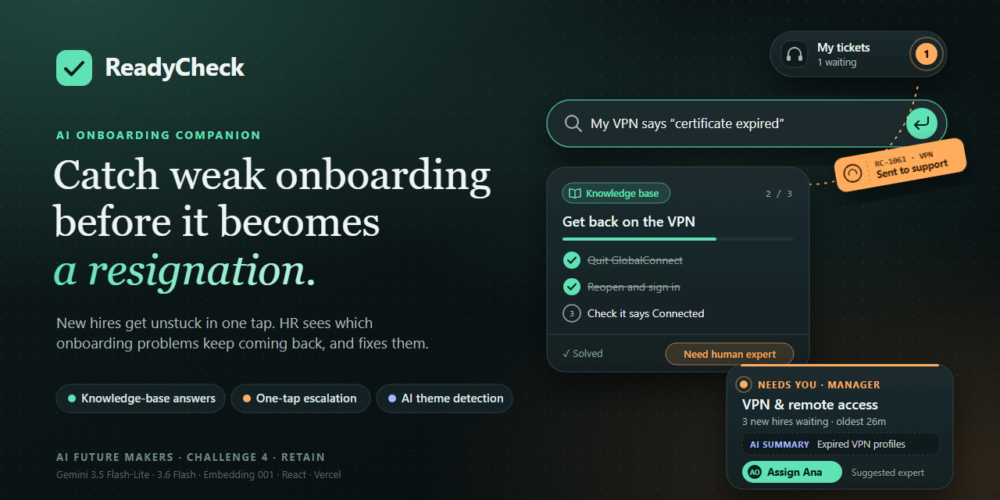
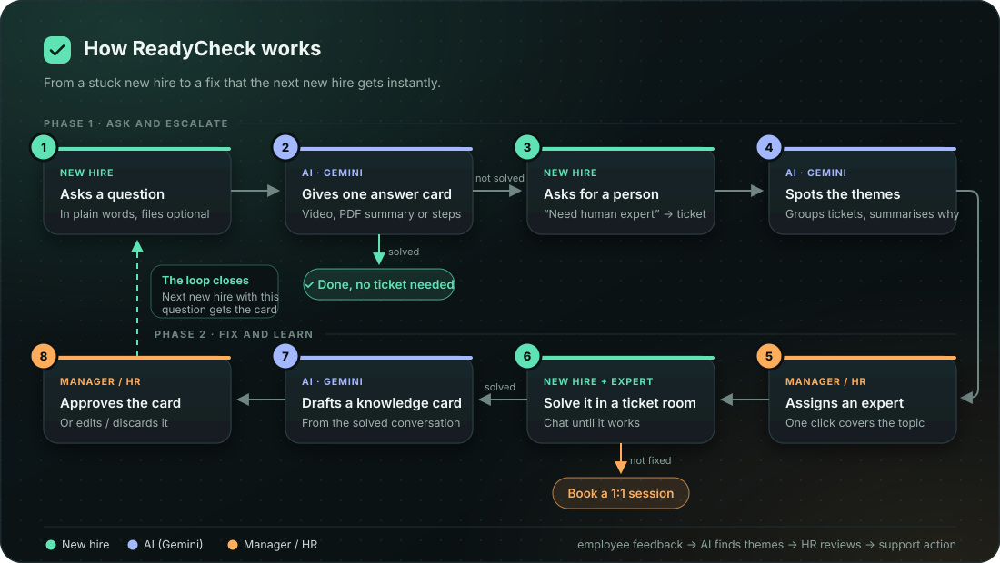
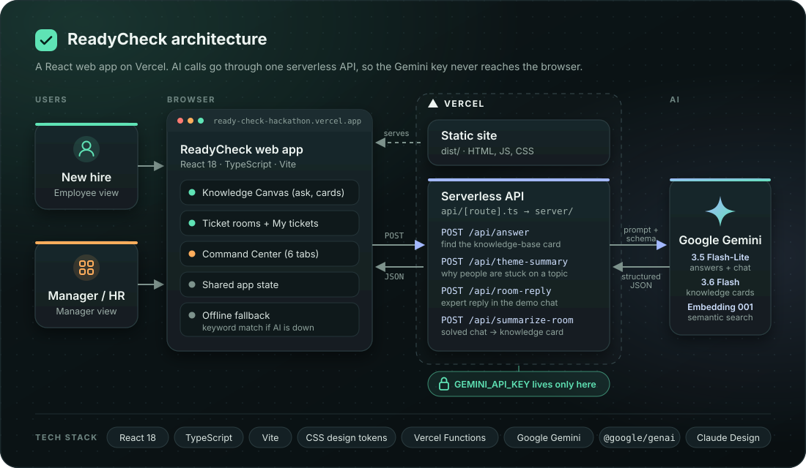

# ReadyCheck



**An AI onboarding companion that helps new employees get unstuck, and shows HR where onboarding is failing.**

Built for AI Future Makers · Challenge 4 (Retain): Early Employee Disengagement.

**Live demo:**[[ready-check-hackathon.vercel.app](https://ready-check-hackathon.vercel.app/)]

---

## The problem

New employees get stuck on small things in their first weeks: the VPN doesn't work, they don't know who their buddy is, they're unsure how to claim an expense.

- They don't know who to ask, so many questions never get asked.
- Each question is small, so HR never sees the pattern.
- A new hire who stays stuck feels unsupported and starts to disengage.
- HR often only finds out in the exit interview, when it's too late.

### This is a real, common problem

| Finding | Source |
|---|---|
| Only **12%** of employees strongly agree their organisation does a great job of onboarding new employees. | [Gallup](https://www.gallup.com/workplace/247172/problems-onboarding-program.aspx) |
| Up to **20%** of employee turnover happens in the **first 45 days**. | O.C. Tanner research, reported by [SHRM](https://www.shrm.org/in/topics-tools/news/hr-magazine/original-onboarding-options-4-hr-leaders) |
| **31%** of people surveyed had quit a job within the **first six months**. Clearer responsibilities (23%) and better training (21%) were among the changes that would have kept them. | BambooHR survey, reported by [HR Dive](https://hrdive.com/news/many-employees-quit-early-due-to-poor-onboarding-survey-says/405359) |
| When managers take an active role in onboarding, employees are **3.4×** as likely to say their onboarding was exceptional. | [Gallup](https://www.gallup.com/workplace/247172/problems-onboarding-program.aspx) |

These studies are a few years old and mostly from the US, but they point the same way as the challenge brief: new hires leave early because of unclear expectations, weak onboarding and too little support, and those problems are visible long before they resign.

## Our solution

ReadyCheck is one website with two views.

**For new employees**
- Ask a question in plain words.
- AI gives **one answer card**: a short video, a policy summary, or a step-by-step checklist.
- If it doesn't help, tap **Need human expert**. The question becomes a ticket.
- Chat with the assigned expert in a **ticket room**. If it's still not fixed, book a **1:1 session**.

**For managers and HR**
- **Needs you:** questions are grouped into topics (for example "VPN" or "Payroll"), with an AI summary of why people are stuck.
- **One click** assigns an expert to everyone stuck on that topic.
- **Knowledge base:** when a problem is solved, AI writes a new answer card. A manager approves it, so the next new hire gets the answer instantly.
- **Home and Trends:** see which topics come up most, by day, week or month.

## Workflow



1. **New hire** asks a question.
2. **AI** gives one answer card based on company's knowledge base. If it helps, done.
3. If not, the **new hire** taps *Need human expert* and a ticket is created.
4. **AI** groups tickets by topic and summarises why people are stuck.
5. **Manager / HR** assigns an expert in one click.
6. The **new hire and expert** solve it in a ticket room. If it's still not fixed, they book a 1:1.
7. **AI** drafts a knowledge card from the solved conversation.
8. **Manager / HR** approves it, so the next new hire with the same question gets the answer straight away.

This matches the challenge's required flow: **employee feedback → AI finds themes → HR/manager reviews → support action**.

## How we use AI

We use **Google Gemini 3.5 Flash-Lite**: fast, low-cost, and good at short structured answers.

| What AI does | What a person still decides |
|---|---|
| Picks or writes the best answer card for a question | The employee says if it helped |
| Groups tickets into topics and summarises each topic | The manager decides who to assign |
| Turns a solved chat into a new knowledge card | The manager approves, edits or discards it |
| Plays the expert in the demo chat (labelled "AI expert (demo)") | In real use, real experts reply |

**Responsible by design**
- Uses only questions employees **choose** to ask. No monitoring, no emotion detection.
- Every AI output is **labelled** in the app.
- Nothing AI writes reaches employees until a **manager approves** it.
- The API key stays on the server, never in the browser.

## Tech stack

| Part | Technology |
|---|---|
| Front end | React 18, TypeScript, Vite |
| Styling | CSS with design tokens (dark and light themes) |
| AI | Google Gemini via the Gemini API (`@google/genai`), including embedding-based retrieval and reranking |
| Back end | Vercel serverless functions |
| Hosting | Vercel |
| Design | Claude Design |

## Architecture



- **Browser:** the React web app has both the employee and manager views.
- **Vercel:** serves the website and runs one serverless API. The Gemini API key is stored only here.
- **Google Gemini:** generates answer JSON, semantic embeddings and a reranked candidate order.
- **Retrieval:** the server keeps an in-memory vector index, ranks candidates with cosine similarity, then uses Gemini as a semantic reranker. It falls back to keyword matching if embeddings are unavailable.

| API endpoint | What it does |
|---|---|
| `/api/answer` | Finds the best answer card for a question |
| `/api/theme-summary` | Summarises why people are stuck on a topic |
| `/api/room-reply` | Writes the expert's reply in the demo chat |
| `/api/summarize-room` | Turns a solved chat into a knowledge card |

The vector index is rebuilt on a cold start. For a multi-instance production deployment, replace the in-memory index with a persistent vector database.

## Run it locally

**You need:** Node.js 18+ and a free Gemini API key from [Google AI Studio](https://aistudio.google.com/apikey).

**1. Install**
```bash
git clone <repository-url>
cd ReadyCheck-hackathon
npm install
```

**2. Add your API key**

Create a file named `.env` in the project folder:
```
GEMINI_API_KEY=your-key-here
GEMINI_CHAT_MODEL=gemini-3.5-flash-lite
GEMINI_SUMMARY_MODEL=gemini-3.6-flash
GEMINI_EMBEDDING_MODEL=gemini-embedding-001
# Optional: minimum cosine similarity for a RAG candidate (default: 0.55)
RAG_MIN_SIMILARITY=0.55
```

**3. Start**
```bash
npm run dev
```

**4. Open**
- Employee view: http://localhost:5173
- Manager view: http://localhost:5173/#manager

## Deploy to Vercel

1. Push the project to GitHub.
2. Import it at [vercel.com/new](https://vercel.com/new).
3. Add `GEMINI_API_KEY` in **Settings → Environment Variables**.
4. Click **Deploy**.

## Run with Docker

Build and start the production container:

```bash
docker build -t readycheck .
docker run --rm -p 3000:3000 \
  -e GEMINI_API_KEY=your-key-here \
  -e GEMINI_MODEL=gemini-3.5-flash-lite \
  readycheck
```
OR
1. Input your GEMINI-API-KEY in .env, following the format of .env.example.
2. Then start the container:
```bash
docker build -t readycheck .
docker run --rm --name readycheck -p 3000:3000 `
  --env-file .env `
  readycheck

```

Open http://localhost:3000. The container serves the Vite build and the `/api/*` endpoints from the same process. If `GEMINI_API_KEY` is omitted, the app still works with its local fallback behaviour, but AI-powered responses are unavailable.

## Try it (2-minute demo)

1. On the employee view, click **Access issue** and press Enter. An answer card appears.
2. Click **Need human expert**. The ticket flies to **My tickets**.
3. Switch to **Manager → Needs you**. Click **Assign Ana**.
4. Open the ticket room and click **▶ Play sample conversation**.
5. Answer **"Did Ana solve your problem?"**. Yes creates a knowledge card; Not yet offers a 1:1.
6. In **Knowledge base**, approve the new card.

## Repository structure

```
ReadyCheck-hackathon/
├── api/
│   └── [route].ts             # Vercel serverless entry for all /api calls
├── server/                    # Back end: Gemini prompts (API key stays here)
│   ├── answer.ts              # Picks or writes the answer card
│   ├── themeSummary.ts        # Summarises why new hires are stuck on a topic
│   └── room.ts                # AI expert replies + knowledge card from a solved chat
├── src/                       # Front end (React + TypeScript)
│   ├── views/
│   │   ├── employee/          # Ask a question, answer cards, My tickets
│   │   └── manager/           # Home, Needs you, Ticket room, Trends, Knowledge base, Expert team
│   ├── components/            # Answer cards, ticket room chat, shared UI
│   ├── state/AppState.tsx     # Shared data: tickets, rooms, knowledge cards
│   └── data/                  # Sample answers, topics, experts, demo chats
├── docs/                      # Workflow and architecture diagrams
├── .env.example               # Template for the Gemini API key
├── Dockerfile                 # Production container definition
├── vercel.json                # Vercel deployment settings
└── package.json               # Scripts and dependencies
```

## Limitations

- This is a prototype. Charts and counts use **sample data**.
- Data resets when the page is refreshed (no database or login yet).
- In the demo, AI plays the expert in chats.
